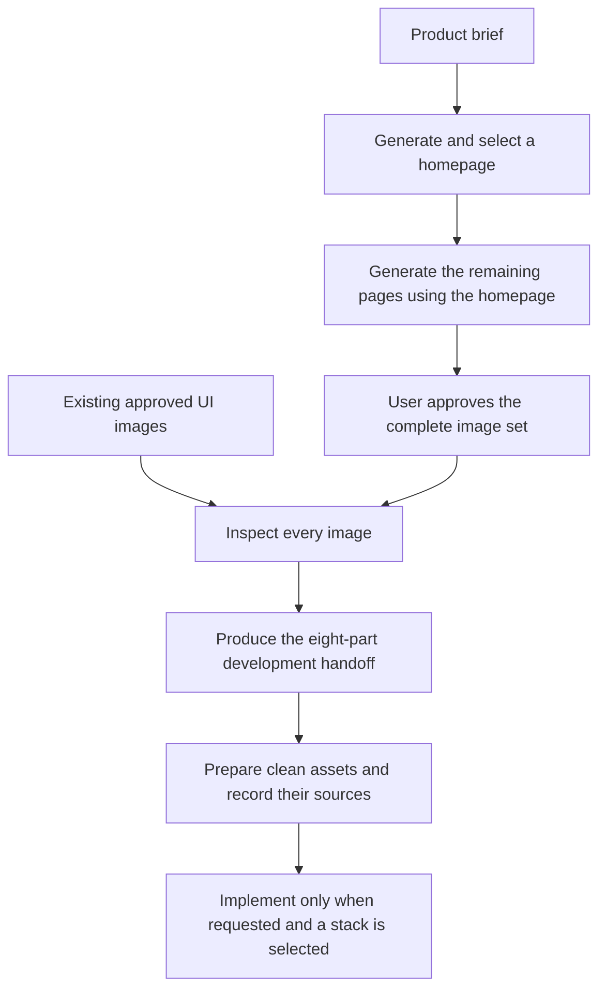

<div align="center">

# Design GPT UI Skills

**Design a coherent UI. Turn the full image set into a practical development handoff.**

A reusable skill for ChatGPT / Codex sessions with built-in image generation.

[](https://github.com/OrangeZh1/Design-GPT-Ui-Skills/actions/workflows/check.yml)
[](LICENSE)
[](#requirements)

**English** · [简体中文](README.zh-CN.md)

[Quick start](#quick-start) · [Workflow](#workflow) · [Deliverables](#deliverables) · [Documentation](#documentation)

</div>

---

## What it does

Start with a product brief or an approved set of UI images. The skill guides the agent through visual design, whole-set analysis, and reusable asset preparation.

| Capability | What you get |
| --- | --- |
| Consistent page design | An approved homepage used as the visual reference for the remaining pages |
| Development handoff | Page structure, shared components, Design Tokens, interactions, and implementation guidance |
| Asset preparation | Clean rectangular crops with boundary checks and recorded source coordinates |
| Existing-design analysis | The same analysis and cropping workflow for UI images you already have |

**No API key configuration or third-party image-generation relay.** Generation uses the host session's built-in image tool. The Python scripts process existing local images; they do not call an image-generation service.

> Installing a skill does not add image-generation capability to a client that lacks it. Image analysis can still proceed when suitable images are supplied and the client can read them.

## Workflow



The complete set is reviewed before individual pages are analyzed. An unspecified technology stack does not block analysis or cropping. Implementation is a separate step requested by the user.

## Quick start

### 1. Install the skill

Clone this repository, then place the complete directory in the skills location supported by your client:

```bash
git clone https://github.com/OrangeZh1/Design-GPT-Ui-Skills.git
```

Keep `SKILL.md`, `references/`, `scripts/`, `agents/`, and `runtime.local.json` together. The installation path and skill-loading procedure depend on the client.

The skill name is **`generate-pages-from-homepage`**.

### 2. Describe the result you need

**Generate a complete UI set**

> Use $generate-pages-from-homepage to design a complete UI for my WeChat mini-program using this session's built-in image generation. Let me select the homepage, then generate the remaining pages with a consistent style. After I approve the complete set, produce the eight-part development handoff and crop the assets listed in the inventory.

**Analyze an existing design**

> I have approved this uploaded UI image set. Inspect every image, analyze each page, extract Design Tokens and shared components, and crop clean, reusable assets for development.

**Request images only**

> Use $generate-pages-from-homepage to design the UI images for my app. I only need images for now.

Provide the product purpose, target platform, core pages, and any design references or exact copy you already have.

### 3. Prepare local asset processing when needed

Actual cropping requires local source images, Python 3.10+, Pillow, and filesystem access:

```bash
python -m pip install Pillow
```

Read the [asset slicing guide](references/asset-slicing.md), build a crop plan from the original image dimensions, and validate it with `--dry-run` before exporting. Preview-scaled coordinates must not be used as source-image coordinates.

## Deliverables

The development handoff contains eight parts:

| # | Deliverable | Contents |
| --- | --- | --- |
| 1 | Complete UI overview | Page inventory, purpose, and relationships |
| 2 | Page-by-page structure | Regions, components, text, layout, and interactions |
| 3 | Shared components and differences | Reuse boundaries, variants, and page-specific modules |
| 4 | Visual specifications | Colors, typography, spacing, and Design Tokens |
| 5 | Interactions and states | Core flows, visible states, and proposed missing states |
| 6 | Asset inventory | Source images, crop regions, export needs, and blockers |
| 7 | Responsive and implementation guidance | Viewports, adaptation, and implementation order |
| 8 | Final delivery checklist | Completed work, verification, and open questions |

See the full [UI analysis and handoff specification](references/ui-analysis.md) for the required tables and evidence labels.

### Evidence stays explicit

Findings are labeled **Directly visible**, **Estimated**, **Inferred**, **To confirm**, or **Proposed addition**. A screenshot is not proof of backend behavior, payment rules, navigation, or exact device metrics.

### Assets stay reusable

- Crop photographs, illustrations, covers, textures, and distinctive brand assets.
- Implement text, buttons, cards, navigation, borders, and ordinary backgrounds as components or CSS.
- Record the original image, crop coordinates, and intended use.
- Flag missing originals or transparency requirements when a clean crop is not possible.
- Treat whole-page screenshots as references, not reusable component assets.

## Requirements

| Task | Requirements |
| --- | --- |
| Read and follow the skill | A client that supports skill instructions and can read the supplied images |
| Generate new UI images | A built-in image-generation tool exposed by the current session |
| Analyze existing images | Readable source images; no new image generation required |
| Export crops | Local originals, filesystem access, Python 3.10+, and Pillow |
| Run repository checks | Python, Pillow, and PyYAML |

`runtime.local.json` contains non-secret workflow defaults. It is not an API client configuration.

When filesystem access is unavailable, the agent can still provide analysis, but must report asset export as pending.

## Documentation

| File | Purpose |
| --- | --- |
| [SKILL.md](SKILL.md) | Workflow stages, capability boundaries, and approval rules |
| [Image generation](references/image-generation.md) | Native generation and reference-image handling |
| [UI analysis](references/ui-analysis.md) | Eight-part handoff, tables, and evidence labels |
| [Asset slicing](references/asset-slicing.md) | Crop planning, coordinates, and export requirements |
| [Implementation quality](references/implementation-quality.md) | Standards for optional code implementation |
| [crop_assets.py](scripts/crop_assets.py) | Rectangular crops, boundary validation, and source records |
| [normalize_image.py](scripts/normalize_image.py) | Optional image-size utility; not applied automatically to UI pages |
| [runtime.local.json](runtime.local.json) | Non-secret workflow defaults |
| [Tests](tests/test_crop_assets.py) | Crop behavior tests |

## Development and contributions

For local syntax and crop checks, run from the repository root:

```bash
python -m pip install Pillow PyYAML
python -m compileall -q scripts tests
python -m unittest discover -s tests -v
```

[GitHub Actions](.github/workflows/check.yml) also validates the runtime configuration and agent YAML.

Issues and pull requests are welcome. For a bug report, include the client, reproduction steps, expected behavior, and relevant errors. For crop issues, provide a reproducible crop plan and source-image dimensions.

## License

[MIT](LICENSE) · Copyright (c) 2026 OrangeZh1.
