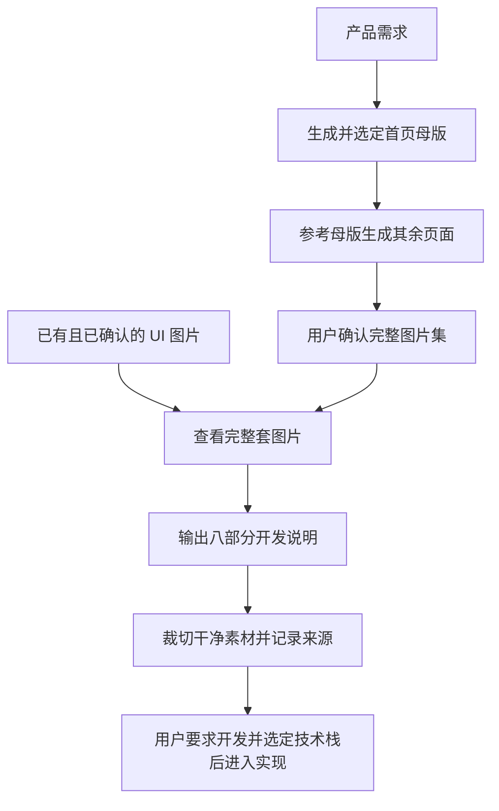

<div align="center">

# Design GPT UI Skills

**设计风格一致的整套 UI，把图片整理成可直接用于开发的交付说明。**

适用于具备内置生图能力的 ChatGPT / Codex 会话的可复用技能。

[](https://github.com/OrangeZh1/Design-GPT-Ui-Skills/actions/workflows/check.yml)
[](LICENSE)
[](#运行要求)

[English](README.md) · **简体中文**

[快速上手](#快速上手) · [工作流程](#工作流程) · [交付内容](#交付内容) · [文档导航](#文档导航)

</div>

---

## 能做什么

从产品需求或用户已确认的 UI 图片出发，完成视觉设计、整套分析和可复用素材准备。

| 能力 | 交付结果 |
| --- | --- |
| 一致的页面设计 | 以选定首页为视觉母版，生成其余页面 |
| 开发交接说明 | 页面结构、公共组件、Design Tokens、交互与实现建议 |
| 素材准备 | 干净的矩形裁图、边界校验与原图坐标记录 |
| 已有设计分析 | 直接分析和裁切已经确认的 UI 图片，无需重新生图 |

**不需要配置 API Key，不调用第三方中转生图接口。** 生图使用当前会话开放的内置工具；Python 脚本只处理已有本地图片，不调用生图服务。

> 安装技能不会让缺少生图工具的客户端获得生图能力。如果客户端能读取图片，仍可分析用户提供的设计图。

## 工作流程



先看全套，再分析单页。技术栈未指定不阻塞分析或裁图；代码实现由用户另行提出。

## 快速上手

### 1. 安装技能

克隆仓库，再把完整目录放入客户端支持的 skills 目录：

```bash
git clone https://github.com/OrangeZh1/Design-GPT-Ui-Skills.git
```

保留 `SKILL.md`、`references/`、`scripts/`、`agents/` 和 `runtime.local.json` 的相对位置。具体安装路径与技能加载方式以所用客户端为准。

技能名称为 **`generate-pages-from-homepage`**。

### 2. 描述所需结果

**生成整套 UI**

> 使用 $generate-pages-from-homepage 为我的微信小程序生成整套 UI，直接调用当前会话的内置生图能力。先让我选定首页，再按一致风格生成其余页面。整套图让我确认后，输出八部分开发说明，并按素材清单裁图。

**分析已有设计**

> 这套上传的 UI 图片我已经确认，请先查看全套，再逐页分析，提取 Design Tokens 和公共组件，裁切可用于开发的独立素材。

**只需要图片**

> 使用 $generate-pages-from-homepage 为我的应用设计 UI，目前只要图片。

尽量提供产品用途、目标平台、核心页面，以及已有的设计参考或准确文案。

### 3. 按需准备本地裁图环境

实际裁图需要本地原图、文件访问能力、Python 3.10+ 和 Pillow：

```bash
python -m pip install Pillow
```

先阅读[素材裁切规范](references/asset-slicing.md)，按原图尺寸建立真实的裁图计划，执行 `--dry-run` 校验后再导出。不能用预览图缩放后的坐标代替原图坐标。

## 交付内容

开发说明包含八部分：

| 序号 | 交付项 | 内容 |
| --- | --- | --- |
| 1 | 整套 UI 概览 | 页面清单、用途和页面关系 |
| 2 | 逐页结构拆解 | 区域、组件、文案、布局和交互 |
| 3 | 公共组件与页面差异 | 复用边界、变体和页面专属模块 |
| 4 | 视觉规范 | 颜色、字体、间距和 Design Tokens |
| 5 | 交互与状态 | 核心流程、可见状态与建议补充状态 |
| 6 | 素材清单 | 来源图片、裁图范围、导出需求和阻碍 |
| 7 | 响应式与实现建议 | 参考视口、适配方式和开发顺序 |
| 8 | 最终交付清单 | 完成情况、验证方式和待确认问题 |

详细表格与确认程度标记见[整套 UI 分析与开发交接规范](references/ui-analysis.md)。

### 明确区分事实与推测

分别标记**明确可见、估算、推测、待确认、建议补充**。截图不能证明后端能力、支付规则、导航关系或精确设备参数。

### 保持素材可复用

- 裁切照片、插画、封面、纹理和特殊品牌素材。
- 文字、按钮、卡片、导航、边框和普通背景由组件或 CSS 实现。
- 记录原图、裁切坐标和用途。
- 无法干净提取或缺少透明版时，明确列出所需原始素材。
- 整页截图只作参考，不冒充可复用组件素材。

## 运行要求

| 任务 | 要求 |
| --- | --- |
| 读取并执行技能 | 客户端支持技能说明，且能读取所提供的图片 |
| 生成新的 UI 图片 | 当前会话开放内置生图工具 |
| 分析已有图片 | 可读取的原图，无需重新生图 |
| 导出裁图 | 本地原图、文件访问能力、Python 3.10+ 和 Pillow |
| 运行仓库检查 | Python、Pillow 和 PyYAML |

`runtime.local.json` 仅包含不含密钥的流程默认值，不是 API 客户端配置。

没有文件访问能力时仍可输出分析，但必须如实标明素材导出待完成。

## 文档导航

| 文件 | 用途 |
| --- | --- |
| [SKILL.md](SKILL.md) | 流程阶段、能力边界与确认规则 |
| [图像生成](references/image-generation.md) | 原生生图与参考图片处理 |
| [UI 分析](references/ui-analysis.md) | 八部分交接说明、表格与确认程度标记 |
| [素材裁切](references/asset-slicing.md) | 裁图计划、坐标与导出要求 |
| [实现质量](references/implementation-quality.md) | 可选代码实现标准 |
| [crop_assets.py](scripts/crop_assets.py) | 矩形裁图、边界校验与来源记录 |
| [normalize_image.py](scripts/normalize_image.py) | 可选尺寸工具，不自动用于 UI 页面 |
| [runtime.local.json](runtime.local.json) | 不含密钥的流程默认值 |
| [测试](tests/test_crop_assets.py) | 裁图行为测试 |

## 开发与贡献

在仓库根目录运行本地语法和裁图检查：

```bash
python -m pip install Pillow PyYAML
python -m compileall -q scripts tests
python -m unittest discover -s tests -v
```

[GitHub Actions](.github/workflows/check.yml) 还会验证运行配置和 agent YAML。

欢迎提交 Issue 和 Pull Request。报告问题时，请提供客户端、复现步骤、预期结果及相关错误。裁图问题请附可复现的裁图计划和原图尺寸。

## 许可证

[MIT](LICENSE) · Copyright (c) 2026 OrangeZh1.
